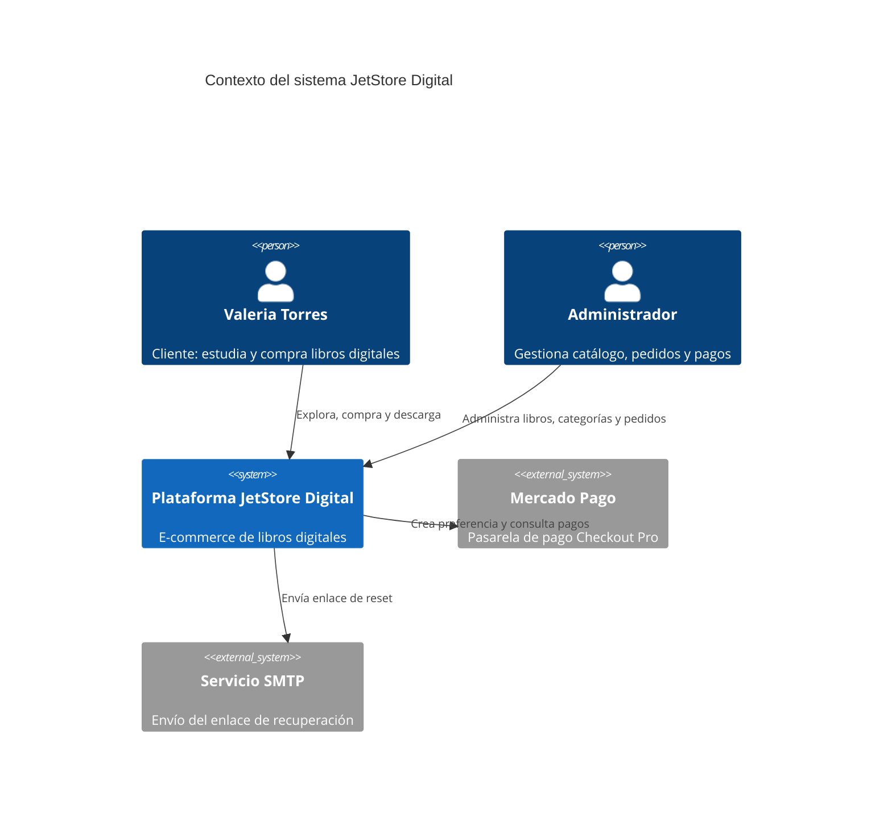
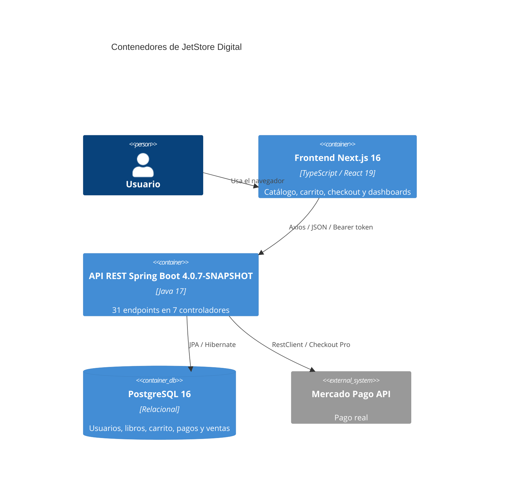
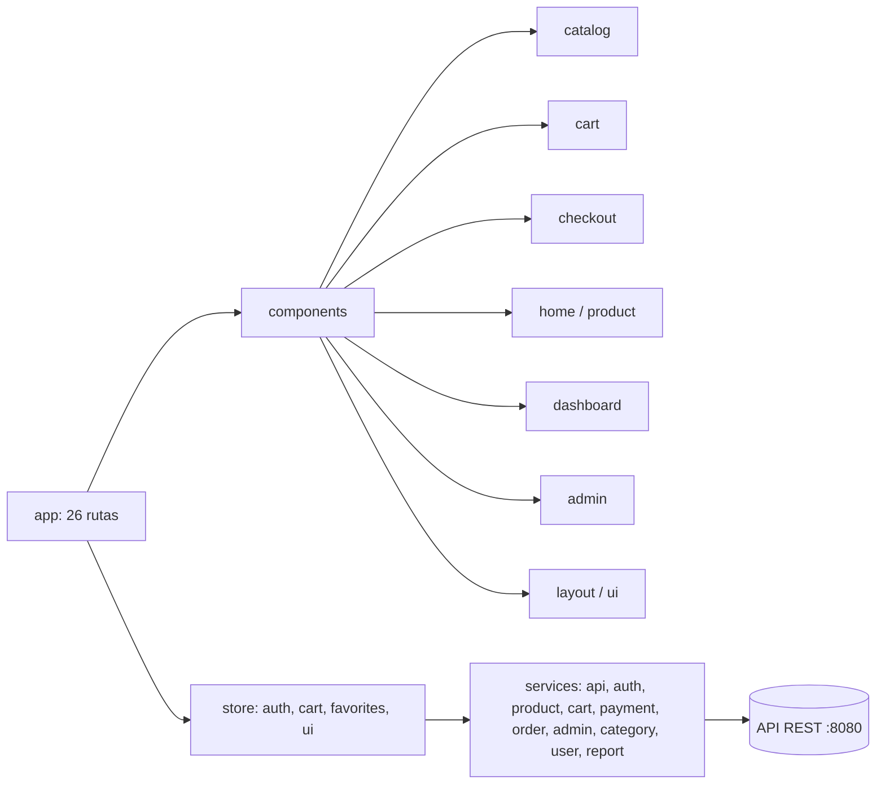
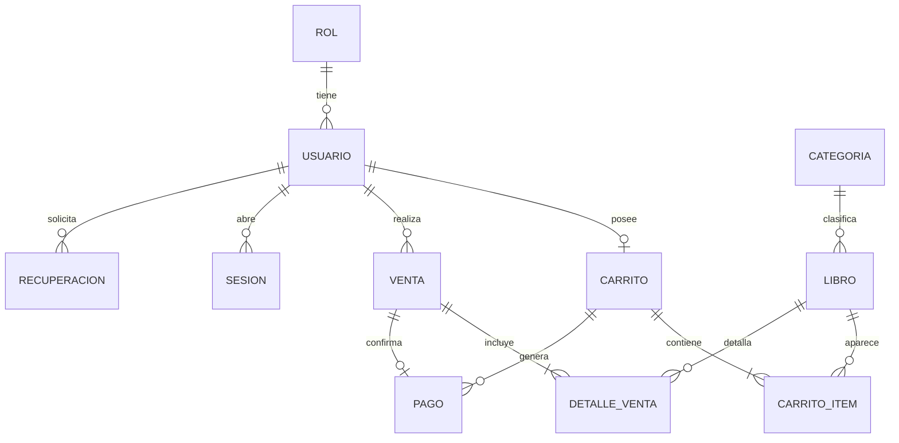
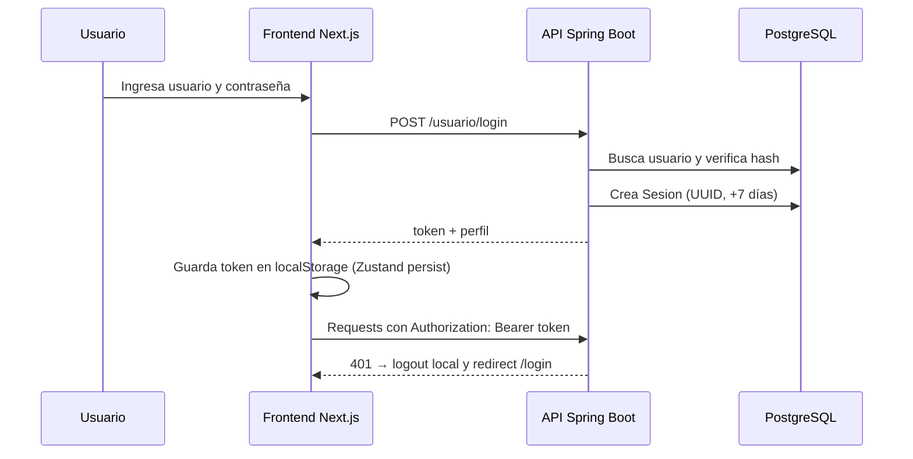
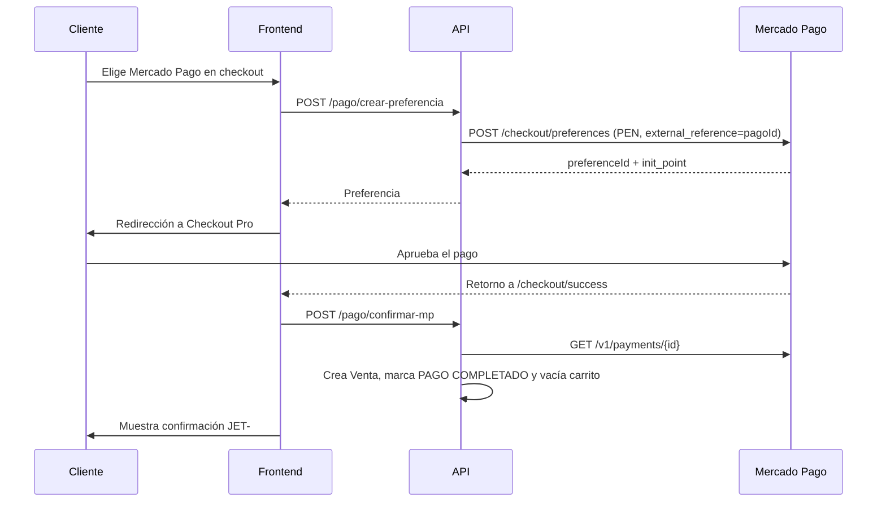
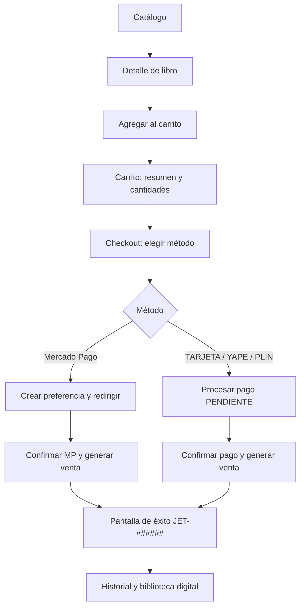
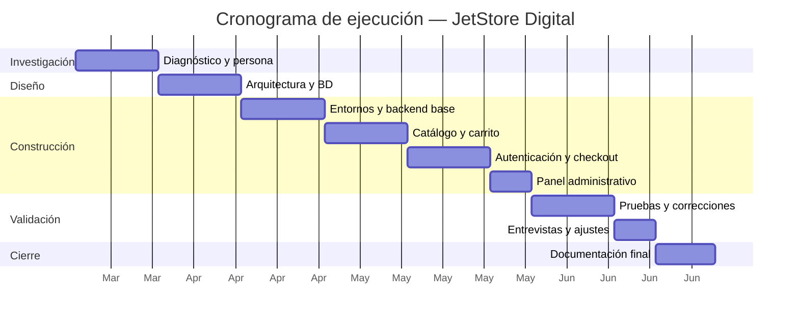

# INFORME FINAL DEL PROYECTO DE INNOVACIÓN TECNOLÓGICA

## Modalidad: Aplicación Profesional

### Instituto de Educación Superior Tecnológico Público "Santiago Antúnez de Mayolo"
**Programa de Diseño y Programación Web — Huancayo, Junín, Perú — 2026**

---

## PORTADA

**Título del proyecto:**  
**Desarrollo e Implementación de la Plataforma Web E-Commerce JetStore para la Comercialización de Libros Digitales**

**Autoras:**  
Castillon De la Cruz, Lucinda  
Flores Vila, Miriam Maryory

**Asesor:**  
Ing. Erick Donniex Moscoso Bravo

**Institución:**  
Instituto de Educación Superior Tecnológico Público "Santiago Antúnez de Mayolo" — IESTP SAM  
Programa de Diseño y Programación Web  
Huancayo, Junín, Perú

**Modalidad:** Aplicación Profesional  
**Año:** 2026

**Líneas de innovación:** Comercio electrónico, plataformas web, transformación digital de microempresas, educación digital.

**Objetivos de Desarrollo Sostenible vinculados:** ODS 9, ODS 8 y ODS 4, con enfoque en Educación para el Desarrollo Sostenible (EDS).

---

## DEDICATORIA

El presente trabajo se dedica, en primer lugar, a la microempresa JetStore Digital y a las personas que, como Valeria Torres, necesitan acceder a material bibliográfico de calidad sin depender de la disponibilidad manual de un vendedor. Que este sistema contribuya a acortar la distancia entre el conocimiento y quienes lo buscan.

Se dedica también a las familias de las autoras, por la confianza, la paciencia y el respaldo constante durante las etapas de investigación, diseño, codificación y validación. Cada revisión, cada prueba y cada corrección lleva implícita su ayuda.

Finalmente, se dedica a la comunidad educativa del Instituto de Educación Superior Tecnológico Público "Santiago Antúnez de Mayolo", cuyo compromiso con la formación técnica ha hecho posible que una idea de negocio se convierta en una solución de software verificable.

---

## AGRADECIMIENTO

Las autoras expresan su reconocimiento al Instituto de Educación Superior Tecnológico Público "Santiago Antúnez de Mayolo" de Huancayo, por la formación impartida en el Programa de Diseño y Programación Web y por las condiciones académicas que permitieron desarrollar este proyecto de innovación tecnológica.

Se agradece de manera especial al Ing. Erick Donniex Moscoso Bravo, asesor del trabajo, por la orientación metodológica, la revisión crítica de los entregables y la exigencia técnica que fortaleció la calidad del producto y de este informe.

Se extiende el agradecimiento a los docentes del programa, a los compañeros que participaron en las sesiones de prueba y a las familias de las autoras, cuyo apoyo fue determinante para culminar la investigación. Asimismo, se reconoce la colaboración de la microempresa JetStore Digital por compartir su problema real y permitir su modelado como caso de aplicación profesional.

---

## ÍNDICE GENERAL

- PORTADA
- DEDICATORIA
- AGRADECIMIENTO
- ÍNDICE GENERAL
- ÍNDICE DE TABLAS
- ÍNDICE DE FIGURAS
- INTRODUCCIÓN
- CAPÍTULO I: PLANTEAMIENTO DEL PROBLEMA
  - 1.1. Identificación del problema
  - 1.2. Identificación del ODS y EDS al que se relaciona el problema
  - 1.3. Descripción del perfil del cliente
  - 1.4. Formulación del Mapa de Empatía
  - 1.5. Formulación del Mapa de trayectoria del cliente
- CAPÍTULO II: DESCRIPCIÓN DE LA PROPUESTA DE INNOVACIÓN
  - 2.1. Visión y misión del proyecto
  - 2.2. Objetivos
  - 2.3. Justificación
  - 2.4. Marco teórico
  - 2.5. Análisis de la competencia
  - 2.6. Análisis FODA
  - 2.7. Formulación del modelo de negocio
- CAPÍTULO III: METODOLOGÍA
  - 3.1. Método
  - 3.1.1. Fases, etapas y herramientas aplicadas
  - 3.1.2. Actividades
- CAPÍTULO IV: DESARROLLO DEL PRODUCTO MÍNIMO VIABLE
  - 4.1. Prototipo de la solución
  - 4.2. Planificación de entrevistas cualitativas
- CAPÍTULO V: VALIDACIÓN DE LA SOLUCIÓN
  - 5.1. Informe de entrevistas cualitativas
  - 5.2. Formulación de la Malla receptora de información
  - 5.3. Formulación del modelo de negocio actualizado post entrevista
- CAPÍTULO VI: IMPLEMENTACIÓN DE LA SOLUCIÓN
  - 6.1. Alcance esperado del proyecto
  - 6.2. Gantt proyectado de ejecución
  - 6.3. Determinación del costo del producto/servicio
  - 6.4. Presupuesto y financiamiento
- CAPÍTULO VII: SOSTENIBILIDAD DEL PROYECTO
  - 7.1. Dimensiones de sostenibilidad
- CONCLUSIONES Y RECOMENDACIONES
- BIBLIOGRAFÍA
- ANEXOS

---

## ÍNDICE DE TABLAS

- Tabla 1. Estructura del informe
- Tabla 2. Diagnóstico del proceso comercial manual
- Tabla 3. Relación del problema con los ODS y la EDS
- Tabla 4. Segmentos de clientes de JetStore Digital
- Tabla 5. Ficha de la Buyer Persona Valeria Torres
- Tabla 6. Mapa de empatía de la Buyer Persona
- Tabla 7. Mapa de trayectoria del cliente: proceso anterior vs. plataforma web
- Tabla 8. Objetivos específicos del proyecto
- Tabla 9. Justificación de la propuesta por dimensiones
- Tabla 10. Antecedentes de investigación
- Tabla 11. Bases teóricas del proyecto
- Tabla 12. Análisis comparativo de la competencia
- Tabla 13. Análisis FODA
- Tabla 14. Matriz de estrategias FODA
- Tabla 15. Lienzo Canvas inicial
- Tabla 16. Fases, etapas y herramientas
- Tabla 17. Actividades ejecutadas por fase
- Tabla 18. Stack tecnológico y versiones declaradas
- Tabla 19. Estructura de rutas del Frontend
- Tabla 20. Componentes del Frontend por área
- Tabla 21. Entidades y tablas del modelo de datos
- Tabla 22. Relaciones entre entidades
- Tabla 23. Catálogo real de libros y precios
- Tabla 24. Endpoints de la API REST
- Tabla 25. Métodos de pago implementados en la interfaz
- Tabla 26. Descripción funcional de las interfaces
- Tabla 27. Ficha técnica de las entrevistas cualitativas
- Tabla 28. Guía de preguntas semiestructuradas
- Tabla 29. Sistematización de hallazgos de las entrevistas
- Tabla 30. Malla receptora de información
- Tabla 31. Lienzo Canvas actualizado
- Tabla 32. Alcance funcional logrado y delimitaciones
- Tabla 33. Cronograma Gantt por semanas
- Tabla 34. Estructura de costos operativos mensuales
- Tabla 35. Precios por categoría editorial
- Tabla 36. Presupuesto — Recursos Humanos
- Tabla 37. Presupuesto — Recursos Materiales
- Tabla 38. Presupuesto — Servicios
- Tabla 39. Resumen general del presupuesto
- Tabla 40. Fuentes de financiamiento propuestas
- Tabla 41. Dimensiones de sostenibilidad
- Tabla 42. Riesgos tecnológicos y mitigaciones
- Tabla 43. Índice descriptivo de anexos

---

## ÍNDICE DE FIGURAS

- Figura 1. Diagrama de contexto C4 del sistema JetStore Digital
- Figura 2. Diagrama de contenedores C4
- Figura 3. Estructura modular del Frontend
- Figura 4. Modelo entidad-relación de la base de datos
- Figura 5. Secuencia de autenticación y control de sesión
- Figura 6. Secuencia de pago con Mercado Pago Checkout Pro
- Figura 7. Flujo funcional de compra
- Figura 8. Cronograma Gantt de ejecución

---

## INTRODUCCIÓN

La comercialización de libros digitales en microempresas locales suele apoyarse en canales informales que resuelven la venta, pero no garantizan trazabilidad, inmediatez ni una experiencia de compra coherente. Ese fue el caso de JetStore Digital, negocio que ofrecía PDF mediante anuncios en Facebook y atención por WhatsApp: cada consulta, verificación de pago y envío de archivo dependía de la intervención manual del vendedor. La ausencia de un catálogo centralizado, de un carrito, de un historial de compras y de un mecanismo de pago verificable generaba demoras, pérdida de información y una dependencia operativa difícil de escalar.

El proyecto propuso y desarrolló una plataforma web de comercio electrónico que integra catálogo, búsqueda y filtros, carrito, autenticación con sesiones, recuperación de contraseña, checkout multi-método, panel administrativo y una API REST construida con Spring Boot sobre PostgreSQL. El frontend se implementó con Next.js 16, React 19 y TypeScript; el backend con Java 17 y Spring Boot 4.0.7-SNAPSHOT; la persistencia con PostgreSQL 16. La integración de pago real corresponde a Mercado Pago Checkout Pro, mientras que Visa, Mastercard, Yape, Plin, transferencia y PayPal permanecen como opciones de interfaz con registro interno de la operación, según se verifica en el código fuente.

El presente informe documenta el proceso completo: diagnóstico del problema, propuesta de innovación, metodología, desarrollo del Producto Mínimo Viable (PMV), validación, implementación y sostenibilidad. La Tabla 1 presenta la estructura de los siete capítulos.

**Tabla 1. Estructura del informe**

| Capítulo | Contenido central |
|----------|-------------------|
| I | Planteamiento del problema, ODS/EDS, perfil del cliente y mapas de empatía y trayectoria |
| II | Propuesta de innovación: visión, objetivos, marco teórico, competencia, FODA y modelo de negocio |
| III | Metodología: combinación de Lean Startup y Scrum, fases, herramientas y actividades |
| IV | Desarrollo del PMV: arquitectura, base de datos, API, interfaces y plan de entrevistas |
| V | Validación: resultados cualitativos, malla receptora y Canvas actualizado |
| VI | Implementación: alcance, cronograma, costos, precios y presupuesto |
| VII | Sostenibilidad social, ambiental, económica y tecnológica |

---

# CAPÍTULO I: PLANTEAMIENTO DEL PROBLEMA

## 1.1. Identificación del problema

JetStore Digital comercializaba libros digitales en formato PDF a través de publicaciones en Facebook y conversaciones por WhatsApp. El proceso comercial no contaba con un sistema que centralizara catálogo, pedidos, pagos ni historial. Cada venta exigía que el vendedor respondiera consultas, verificara manualmente el comprobante de pago y enviara el archivo de forma individual. Como resultado, la operación era lenta, dependiente de una sola persona y vulnerable a errores de registro o pérdida de información.

El diagnóstico se sistematiza en la Tabla 2.

**Tabla 2. Diagnóstico del proceso comercial manual**

| Etapa del proceso manual | Limitación identificada | Consecuencia para el cliente |
|--------------------------|-------------------------|------------------------------|
| Publicación del libro en Facebook | Información dispersa y sin actualización centralizada | Duda sobre disponibilidad y precio |
| Consulta por WhatsApp | Respuesta dependiente del vendedor | Espera y fricción en la decisión de compra |
| Verificación manual del pago | Sin registro automático ni validación trazable | Incertidumbre sobre el estado de la compra |
| Envío individual del PDF | Entrega manual y no repetible | Demora y riesgo de omisión |
| Sin historial centralizado | No se conserva registro de compras | Imposibilidad de consultar adquisiciones posteriores |

**Problema central:** la microempresa JetStore Digital no contaba con una plataforma web que integrara de forma automática y trazable la publicación del catálogo, la gestión del carrito, la confirmación de pagos y el acceso al historial de compras de libros digitales.

**Pregunta problema:** ¿Cómo diseñar e implementar una plataforma web de comercio electrónico que permita a JetStore Digital comercializar libros digitales de forma centralizada, reduciendo la dependencia del vendedor y ofreciendo al cliente un recorrido de compra claro, verificable y disponible en línea?

La solución implementada respondió a esta pregunta mediante un sistema dividido en una interfaz web progresiva y una API REST, con persistencia en PostgreSQL y separación entre la lógica de catálogo, carrito, pago y administración.

## 1.2. Identificación del ODS y EDS al que se relaciona el problema

La propuesta se vincula con tres Objetivos de Desarrollo Sostenible y con la Educación para el Desarrollo Sostenible, según se detalla en la Tabla 3.

**Tabla 3. Relación del problema con los ODS y la EDS**

| Referencia | Relación con el proyecto |
|------------|--------------------------|
| ODS 9 — Industria, Innovación e Infraestructura | Incorpora infraestructura tecnológica web, una API REST desacoplada y procesos digitales para una microempresa. |
| ODS 8 — Trabajo decente y crecimiento económico | Permite ampliar la capacidad de venta sin incrementar proporcionalmente el trabajo manual y abre canales de ingresos digitales. |
| ODS 4 — Educación de calidad | Facilita el acceso a material bibliográfico de formación profesional y continua en formato digital. |
| EDS | Promueve una cultura de acceso abierto al conocimiento, uso responsable de tecnologías y aprendizaje continuo a lo largo de la vida. |

## 1.3. Descripción del perfil del cliente

La investigación identificó tres segmentos con necesidades diferenciadas, resumidos en la Tabla 4.

**Tabla 4. Segmentos de clientes de JetStore Digital**

| Segmento | Caracterización | Necesidad principal |
|----------|-----------------|---------------------|
| Estudiante | Joven en formación técnica o universitaria, con presupuesto limitado y alta frecuencia de consulta | Material de estudio accesible, de bajo costo y descarga inmediata |
| Profesional / Trabajador | Persona empleada que busca actualizarse en áreas técnicas o de gestión | Contenido aplicable al trabajo, disponible fuera del horario laboral |
| Lector digital | Persona que prefiere formatos electrónicos por comodidad y portabilidad | Catálogo ordenado, historial y biblioteca personal |

La Buyer Persona principal se presenta en la Tabla 5.

**Tabla 5. Ficha de la Buyer Persona Valeria Torres**

| Atributo | Detalle |
|----------|---------|
| Nombre | Valeria Torres |
| Edad | 24 años |
| Ocupación | Estudiante y trabajadora |
| Nivel socioeconómico | NSE Medio |
| Ubicación | Huancayo, Junín, Perú |
| Objetivo | Acceder a libros digitales de calidad para estudiar y trabajar sin depender de horarios de atención |
| Motivación de compra | Precio accesible, inmediatez y confianza en el proceso de pago |
| Objeciones | Temor a pagar sin recibir el archivo, dudas sobre la seguridad del sitio y falta de historial |
| Canal preferido | Dispositivo móvil y navegador web |
| Frase representativa | «Quiero comprar, descargar y seguir estudiando sin esperar a que me respondan por WhatsApp». |

## 1.4. Formulación del Mapa de Empatía

El mapa de empatía de la Tabla 6 sintetiza los hallazgos cualitativos del diagnóstico.

**Tabla 6. Mapa de empatía de la Buyer Persona**

| Dimensión | Hallazgos |
|-----------|-----------|
| Qué piensa y siente | Desconfianza frente al pago manual; deseo de simplicidad; preocupación por recibir efectivamente el PDF. |
| Qué ve | Anuncios en Facebook, conversaciones largas por WhatsApp, poca información sobre stock y precios. |
| Qué oye | Comentarios de amigos sobre compras digitales y recomendaciones de tiendas en línea. |
| Qué dice y hace | Pregunta por disponibilidad, solicita el comprobante, espera el envío del archivo y vuelve a consultar si no hay respuesta. |
| Esfuerzos / dificultades | Coordinar horarios, verificar pagos sin herramientas, conservar mensajes como único comprobante. |
| Resultados esperados | Compra en pocos pasos, confirmación visible, acceso inmediato a la biblioteca e historial de pedidos. |

Desde una perspectiva de experiencia de usuario, el hallazgo más relevante es la necesidad de **feedback visible**: la persona necesita saber en cada momento si su pago fue recibido, si la orden fue confirmada y dónde quedó el archivo adquirido.

## 1.5. Formulación del Mapa de trayectoria del cliente

La Tabla 7 compara las ocho etapas del recorrido manual con el trayecto optimizado que ofrece la plataforma.

**Tabla 7. Mapa de trayectoria del cliente: proceso anterior vs. plataforma web**

| # | Etapa | Proceso manual anterior | Recorrido con JetStore Digital |
|---|-------|-------------------------|--------------------------------|
| 1 | Descubrimiento | Publicación aislada en Facebook | Portada web con catálogo y secciones de confianza |
| 2 | Exploración | Mensajes para preguntar por títulos | Catálogo con búsqueda y filtros |
| 3 | Evaluación | Precio y disponibilidad por WhatsApp | Ficha de libro con precio, stock y formato |
| 4 | Selección | Lista de deseos informal | Carrito persistente con subtotal |
| 5 | Pago | Comprobante enviado y verificado manualmente | Checkout con Mercado Pago u otros métodos registrados |
| 6 | Confirmación | Mensaje manual del vendedor | Pantalla de éxito con número de pedido `JET-######` |
| 7 | Entrega | PDF enviado por chat | Biblioteca digital e historial en el dashboard |
| 8 | Postventa | Sin historial centralizado | Compras, favoritos y perfil disponibles en línea |

---

# CAPÍTULO II: DESCRIPCIÓN DE LA PROPUESTA DE INNOVACIÓN

## 2.1. Visión y misión del proyecto

**Visión.** Ser una plataforma web de referencia para la comercialización digital de libros técnicos y de formación en microempresas peruanas, reconocida por su simplicidad, trazabilidad y capacidad de crecimiento.

**Misión.** Ofrecer a JetStore Digital y a sus clientes un sistema de comercio electrónico que centralice el catálogo, automatice la gestión de carrito y pagos, y garantice una experiencia de compra clara, segura y disponible en cualquier momento.

## 2.2. Objetivos

**Objetivo general.** Desarrollar e implementar una plataforma web de comercio electrónico que permita a JetStore Digital comercializar libros digitales de forma centralizada, automatizada y trazable, mejorando la experiencia de compra de sus clientes.

**Tabla 8. Objetivos específicos del proyecto**

| # | Objetivo específico |
|---|---------------------|
| OE1 | Diagnosticar el proceso manual de venta y caracterizar al cliente objetivo mediante mapas de empatía y trayectoria. |
| OE2 | Diseñar una arquitectura web desacoplada con frontend Next.js, API REST Spring Boot y base de datos PostgreSQL. |
| OE3 | Implementar los módulos funcionales del PMV: catálogo, carrito, autenticación, checkout y panel administrativo. |
| OE4 | Validar la usabilidad y el flujo de compra con usuarios mediante entrevistas cualitativas y pruebas funcionales. |
| OE5 | Evaluar la viabilidad técnica, económica y de sostenibilidad de la solución para su continuidad operativa. |

## 2.3. Justificación

La justificación se organiza en cuatro dimensiones, según la Tabla 9.

**Tabla 9. Justificación de la propuesta por dimensiones**

| Dimensión | Justificación |
|-----------|---------------|
| Tecnológica | Se sustituye un proceso manual por una arquitectura con API REST, persistencia relacional y una interfaz responsiva construida con tecnologías vigentes. |
| Operativa | Se elimina la verificación manual de pagos y el envío individual de archivos; el vendedor administra catálogo y pedidos desde un panel. |
| Experiencia de usuario | El cliente dispone de búsqueda, filtros, carrito, estados de pago, confirmación e historial con feedback visible en cada etapa. |
| Innovación incremental | No se sustituye el negocio, sino que se digitalizan sus procesos actuales con mejoras medibles en tiempo y trazabilidad. |

La innovación es incremental porque conserva el modelo de negocio de la microempresa —venta de libros PDF— y transforma únicamente la forma en que se publica, paga, confirma y registra cada operación.

## 2.4. Marco teórico

### Antecedentes

**Tabla 10. Antecedentes de investigación**

| Referencia | Aporte al proyecto |
|------------|--------------------|
| Huamán Carhuallanqui (2024) | Estudio referido en el perfil aprobado sobre el uso de plataformas web para la digitalización de microempresas; sirve como antecedente del enfoque de aplicación profesional. |
| Cruz Castro et al. (2022) | Trabajo referido en el perfil aprobado sobre comercio electrónico y procesos de compra digital; aporta el marco comparativo para la experiencia de usuario. |

> Nota metodológica: los datos bibliográficos completos de ambos antecedentes deben completarse con la ficha original del perfil aprobado. El repositorio no contiene las publicaciones, por lo que no se han inventado títulos ni revistas.

### Bases teóricas

**Tabla 11. Bases teóricas del proyecto**

| Concepto | Definición aplicada al proyecto |
|----------|---------------------------------|
| Comercio electrónico | Proceso de compra y venta de bienes mediante redes digitales; en el proyecto se materializa en catálogo, carrito, pago y confirmación en línea. |
| Plataforma web | Sistema accesible mediante navegador, implementado con Next.js 16 y una API REST en Spring Boot. |
| UX y usabilidad (ISO 9241-11) | Grado en que un producto permite a un usuario lograr objetivos concretos con eficacia, eficiencia y satisfacción en un contexto de uso determinado. |
| Base de datos | Modelo relacional en PostgreSQL que centraliza usuarios, libros, carrito, pagos y ventas. |
| Autenticación y control de acceso | Identificación del usuario mediante token UUID de sesión con vigencia de siete días; los roles ADMIN y CLIENTE se gestionan en la interfaz. |
| Producto Mínimo Viable | Versión del sistema con las funcionalidades suficientes para probar el flujo completo de compra y obtener retroalimentación. |

La norma ISO 9241-11 orientó la evaluación de la usabilidad: eficacia (completar la compra), eficiencia (número de pasos y tiempo) y satisfacción (percepción de claridad y confianza).

## 2.5. Análisis de la Competencia

**Tabla 12. Análisis comparativo de la competencia**

| Alternativa | Fortalezas | Limitaciones frente a JetStore Digital |
|-------------|-----------|----------------------------------------|
| Amazon Kindle | Catálogo masivo, lector propio y pagos maduros | No atiende catálogo técnico local ni la relación directa con la microempresa |
| Google Play Books | Integración con ecosistema Android y amplia disponibilidad | Requiere ecosistema propio; no ofrece atención ni precios en soles para este nicho |
| Kobo | Buen lector y catálogo internacional | Sin foco en material técnico peruano ni administración local |
| Facebook | Alto alcance y fácil publicación | Sin carrito, sin pago integrado, sin historial y sin trazabilidad de pedidos |
| WhatsApp | Comunicación directa y rápida | Dependencia total del vendedor; pagos y entregas manuales; sin catálogo estructurado |
| JetStore Digital | Catálogo propio, filtros, carrito, checkout, dashboard, precios en soles y flujo de compra centralizado | Menor escala y catálogo más reducido; PayPal y descarga de PDF aún simulados |

La ventaja competitiva no reside en el tamaño del catálogo, sino en la **reducción de fricción** para un público local que necesita material técnico concreto con confirmación inmediata.

## 2.6. Análisis FODA

**Tabla 13. Análisis FODA**

| Fortalezas | Debilidades |
|------------|-------------|
| Arquitectura desacoplada frontend/backend | Control de roles solo en frontend |
| 31 endpoints REST operativos | 7 endpoints sin documentar en `openapi.md` |
| 109 archivos de test y 591 pruebas documentadas | Descarga de PDF y comprobantes simuladas |
| Catálogo real de 15 libros con precios definidos | PayPal y algunos formularios de pago no conectados |
| Sesiones UUID y recuperación de contraseña funcional | Configuración de Docker con ruta `Frontend/frontend` inexistente |

| Oportunidades | Amenazas |
|---------------|----------|
| Crecimiento del consumo de contenido digital en Perú | Competencia de grandes plataformas globales |
| Demanda de material técnico y profesional | Cambios en comisiones de pasarelas de pago |
| Posibilidad de alianzas con instituciones educativas | Riesgos de seguridad al no existir validación server-side de tokens |
| Automatización de reportes administrativos | Dependencia de un único proveedor de pago real |

**Tabla 14. Matriz de estrategias FODA**

| Estrategia | Acción propuesta |
|------------|------------------|
| FO — Fortalezas + Oportunidades | Usar el catálogo técnico y el checkout con Mercado Pago para llegar a institutos y profesionales de Junín. |
| DO — Debilidades + Oportunidades | Documentar los 7 endpoints faltantes y reforzar la validación de roles para aumentar la confianza de posibles aliados. |
| FA — Fortalezas + Amenazas | Diferenciarse por atención local, precios en soles y material relevante para el contexto peruano. |
| DA — Debilidades + Amenazas | Implementar control de acceso en servidor y diversificar proveedores de pago para reducir dependencia y riesgo. |

## 2.7. Formulación del modelo de negocio

**Tabla 15. Lienzo Canvas inicial**

| Bloque | Contenido inicial |
|--------|-------------------|
| 1. Segmentos de clientes | Estudiantes, profesionales/trabajadores y lectores digitales de NSE medio |
| 2. Propuestas de valor | Libros digitales técnicos a precios accesibles, compra en línea y acceso inmediato |
| 3. Canales | Plataforma web, Facebook y enlaces compartidos por WhatsApp |
| 4. Relaciones con clientes | Atención por WhatsApp, correo de recuperación y dashboard de compras |
| 5. Fuentes de ingresos | Venta de libros PDF en soles (S/ 16.00 a S/ 35.00) |
| 6. Recursos clave | Catálogo, plataforma web, API REST, base de datos y equipo de desarrollo |
| 7. Actividades clave | Publicación de libros, administración de stock, soporte y mantenimiento |
| 8. Socios clave | Mercado Pago, proveedor de hosting, servicio de correo SMTP |
| 9. Estructura de costos | Desarrollo, hosting, dominio, base de datos, correo y comisiones de pago |

---

# CAPÍTULO III: METODOLOGÍA

## 3.1. Método

La investigación adoptó un enfoque mixto con dominante cualitativa y se apoyó en dos marcos complementarios. **Lean Startup** permitió construir, medir y aprender iterativamente a partir del PMV: se partió de una hipótesis de valor —la compra digital reduce la fricción del proceso manual—, se implementó un producto mínimo y se validó con pruebas funcionales y entrevistas. **Scrum** aportó la organización del trabajo en iteraciones cortas con roles, eventos e incrementos verificables, adecuados para un equipo de dos desarrolladoras con asesoramiento técnico.

La combinación se justifica porque Lean Startup responde al **qué y por qué** se construye, mientras que Scrum responde al **cómo** se coordina la construcción. El resultado es un método que reduce el riesgo de desarrollar funcionalidades no deseadas y, al mismo tiempo, mantiene control sobre alcance, tiempo y calidad.

## 3.1.1. Fases, etapas y herramientas aplicadas

**Tabla 16. Fases, etapas y herramientas**

| Fase | Etapa | Herramientas reales usadas |
|------|-------|----------------------------|
| 1. Investigación | Diagnóstico, persona, mapas | Entrevistas, Facebook/WhatsApp como evidencia, documentos `README.md` y `ARQUITECTURA_C4.md` |
| 2. Diseño | Arquitectura C4, modelo de datos, mockups | Markdown, Mermaid, PostgreSQL 16, draw.io como alternativa de diagramación |
| 3. Construcción | Frontend y backend | VS Code, Git/GitHub, Next.js 16, React 19, TypeScript, Tailwind v4, Axios, Zustand, Zod, Spring Boot 4.0.7-SNAPSHOT, Java 17, Lombok, Maven |
| 4. Validación | Pruebas unitarias y entrevistas | Vitest 2, Testing Library, jsdom, JUnit 5, Mockito, JaCoCo, Playwright CLI |
| 5. Despliegue | Contenedores y configuración | Docker Engine 24+, Docker Compose v2, `postgres:16-alpine`, `node:22-alpine`, `eclipse-temurin:17-jre` |
| 6. Documentación | Informe final y anexos | Markdown, tablas Markdown, diagramas Mermaid, repositorio Git |

La Tabla 18 del capítulo IV detalla las versiones exactas declaradas en los archivos de configuración.

## 3.1.2. Actividades

**Tabla 17. Actividades ejecutadas por fase**

| Fase / Sprint | Actividades principales | Entregable |
|---------------|-------------------------|------------|
| Fase 1 — Investigación | Entrevista con la microempresa, análisis del canal Facebook/WhatsApp, construcción de la persona | Diagnóstico y mapas de empatía/trayectoria |
| Fase 2 — Diseño | Modelado C4, definición de entidades, diseño de endpoints y prototipo de interfaces | Arquitectura y contrato API |
| Sprint 1 | Configuración de proyectos, base de datos, entidades y autenticación | Backend base y frontend base |
| Sprint 2 | Catálogo, búsqueda, filtros, carrito y ficha de producto | Flujo de exploración y selección |
| Sprint 3 | Checkout, sesiones, recuperación y panel administrativo | Flujo de compra y administración |
| Sprint 4 | Pruebas, corrección de fallos y documentación | Suite de pruebas e informes |

La ejecución real dejó evidencia de 109 archivos de test y 591 pruebas aprobadas en los reportes `Frontend/coverage_full.txt` y `Frontend/coverage3.txt`, con una cobertura de sentencias de 86,13 %. El archivo `failures.txt` conserva una ejecución intermedia con 28 pruebas fallidas, ya superada según los reportes posteriores.

---

# CAPÍTULO IV: DESARROLLO DEL PRODUCTO MÍNIMO VIABLE

## 4.1. Prototipo de la solución

### Arquitectura C4

La Figura 1 muestra el contexto del sistema: la cliente Valeria y el administrador interactúan con la plataforma; el sistema se integra con Mercado Pago para el cobro real y con un servicio de correo para la recuperación de contraseña.

**Figura 1. Diagrama de contexto C4 del sistema JetStore Digital**

La Figura 2 detalla los contenedores: una aplicación web Next.js, una API Spring Boot y la base de datos PostgreSQL.

**Figura 2. Diagrama de contenedores C4**

### Stack tecnológico exacto

**Tabla 18. Stack tecnológico y versiones declaradas**

| Capa | Tecnología / dependencia | Versión declarada | Fuente |
|------|--------------------------|-------------------|--------|
| Frontend | Next.js | 16.2.9 | `Frontend/package.json:18` |
| Frontend | React / React DOM | 19.2.4 | `Frontend/package.json:19-20` |
| Frontend | TypeScript | ^5 | `Frontend/package.json:42` |
| Frontend | Tailwind CSS / @tailwindcss/postcss | ^4 | `Frontend/package.json:28,41` |
| Frontend | Axios | ^1.18.0 | `Frontend/package.json:16` |
| Frontend | Zod | ^4.4.3 | `Frontend/package.json:24` |
| Frontend | Zustand | ^5.0.14 | `Frontend/package.json:25` |
| Frontend | React Hook Form / @hookform/resolvers | ^7.79.0 / ^5.4.0 | `Frontend/package.json:15,21` |
| Frontend | Framer Motion | ^12.40.0 | `Frontend/package.json:17` |
| Frontend | React Icons | ^5.6.0 | `Frontend/package.json:22` |
| Frontend | SweetAlert2 | ^11.26.25 | `Frontend/package.json:23` |
| Pruebas frontend | Vitest / @vitest/coverage-v8 | ^2.1.9 | `Frontend/package.json:36,43` |
| Pruebas frontend | Testing Library React / jest-dom / user-event | ^16.3.2 / ^6.9.1 / ^14.6.1 | `Frontend/package.json:29-31` |
| Backend | Spring Boot Starter Parent | 4.0.7-SNAPSHOT | `backend/pom.xml:6-8` |
| Backend | Java | 17 | `backend/pom.xml:30` |
| Backend | Spring Data JPA, WebMVC, Validation, Mail, RestClient | versión del parent | `backend/pom.xml:34-51` |
| Backend | PostgreSQL Driver | gestionado por BOM | `backend/pom.xml:55-57` |
| Backend | Lombok | gestionado por BOM | `backend/pom.xml:60-62` |
| Backend | JaCoCo | 0.8.12 | `backend/pom.xml:89-91` |
| Base de datos | PostgreSQL | 16-alpine | `docker-compose.yml:3` |
| Infraestructura | Node (Dockerfile) | 22-alpine | `Frontend/Dockerfile:2` |
| Infraestructura | Maven / JRE (Dockerfile) | 3.9-eclipse-temurin-17 / 17-jre | `backend/Dockerfile:2,10` |

El backend no declara Spring Security, JWT ni SDK de Mercado Pago: la autenticación es un token UUID propio y la comunicación con la pasarela se realiza mediante `RestClient`.

### Estructura del Frontend

La Tabla 19 enumera las 26 rutas del proyecto y la Tabla 20 los componentes por área. La Figura 3 resume la estructura modular.

**Tabla 19. Estructura de rutas del Frontend**

| Ámbito | Rutas |
|--------|-------|
| Público y autenticación | `/`, `/catalogo`, `/producto/[id]`, `/carrito`, `/checkout`, `/checkout/success`, `/login`, `/registro`, `/contacto`, `/recuperar-contrasena`, `/reset-password` |
| Cliente | `/dashboard`, `/dashboard/perfil`, `/dashboard/favoritos`, `/dashboard/configuracion`, `/dashboard/biblioteca`, `/dashboard/compras` |
| Administración | `/admin`, `/admin/configuracion`, `/admin/logs`, `/admin/productos`, `/admin/pagos`, `/admin/categorias`, `/admin/reportes`, `/admin/usuarios`, `/admin/pedidos` |

**Tabla 20. Componentes del Frontend por área**

| Área | Componentes reales |
|------|--------------------|
| Catálogo | `CatalogoView`, `ProductFilters`, `ProductGrid`, `ProductSort`, `SearchBar` |
| Carrito | `CartItem`, `CartSummary` |
| Checkout | `CheckoutForm`, `OrderConfirmation`, `OrderSummary`, `MercadoPagoCardForm`, `PaymentMethods`, `PaymentVisa`, `PaymentMastercard`, `PaymentYape`, `PaymentPlin`, `PaymentTransfer`, `PaymentPayPal` |
| Inicio | `Hero`, `Stats`, `Categories`, `FeaturedProducts`, `Benefits`, `HowItWorks`, `Testimonials`, `FAQ`, `Newsletter` |
| Dashboard | `FavoritesList`, `DigitalLibrary`, `PurchaseHistory`, `ProfileForm`, `SettingsForm` |
| Administración | `AdminHeader`, `AdminSidebar`, `CategoriesTable`, `Charts`, `LogsView`, `OrdersTable`, `PaymentsTable`, `ProductsTable`, `ReportsView`, `StatsCards`, `UsersTable` |
| Layout | `Navbar`, `Footer`, `Sidebar`, `DashboardLayout` |
| Producto | `ProductGallery`, `ProductInfo`, `RelatedProducts` |
| UI | `Alert`, `Badge`, `Breadcrumb`, `Button`, `Card`, `Input`, `Loader`, `Modal`, `Pagination`, `Select`, `Spinner`, `Table`, `Textarea`, `Toast` |

**Figura 3. Estructura modular del Frontend**

### Modelo de Base de Datos

El esquema se genera con Hibernate mediante `spring.jpa.hibernate.ddl-auto=update` (`application.properties:9`); el repositorio no contiene archivos `.sql` ni migraciones Flyway/Liquibase. La base se denomina `jetstore`, el usuario `jetstore_admin` y el puerto 5432.

**Tabla 21. Entidades y tablas del modelo de datos**

| Entidad | Tabla | Campos principales |
|---------|-------|--------------------|
| `Usuario` | `usuario` | `id`, `nombreUsuario`, `correo`, `passwordHash`, `rol` |
| `Rol` | `rol` | `id`, `nombre` (ADMIN, CLIENTE sembrados) |
| `Sesion` | `sesion` | `id`, `token` UUID único, `usuario_id`, `fechaCreacion`, `fechaExpiracion` (+7 días), `activa` |
| `Recuperacion` | `recuperacion` | `id`, `token` único, `usuario_id`, expiración (1 h por defecto), `utilizado` |
| `Categoria` | `categoria` | `id`, `nombre`, `descripcion` |
| `Libro` | `libro` | `id`, `titulo`, `autor`, `categoria`, `precio`, `formato`, `imagen`, `stock`, `fechaCreacion` |
| `Carrito` | `carrito` | `id`, `usuario_id` único, `items`, `fechaCreacion` |
| `CarritoItem` | `carrito_item` | `id`, `carrito_id`, `libro_id`, `cantidad`; `subtotal = precio × cantidad` |
| `Venta` | `venta` | `id`, `usuario_id`, `detalles`, `total`, `aplicaBono`, `fechaHora` |
| `DetalleVenta` | `detalle_venta` | `id`, `id_venta`, `libro_id`, `cantidad`, `subTotal` |
| `Pago` | `pago` | `id`, `carrito_id`, `venta_id`, `metodoPago`, `estado`, `montoTotal`, `referencia`, `mpPreferenceId`, `mpPaymentId`, `mpInitPoint`, fechas |
| `Cliente` | `cliente` | `id`, `nombres`, `apellidos`, `dni`, `correo`, `telefono` |

**Tabla 22. Relaciones entre entidades**

| Relación | Cardinalidad |
|----------|--------------|
| `Rol` → `Usuario` | 1 : N |
| `Usuario` → `Carrito` | 1 : 1 |
| `Carrito` → `CarritoItem` | 1 : N |
| `Libro` → `CarritoItem` | 1 : N |
| `Categoria` → `Libro` | 1 : N |
| `Usuario` → `Venta` | 1 : N |
| `Venta` → `DetalleVenta` | 1 : N |
| `Libro` → `DetalleVenta` | 1 : N |
| `Carrito` → `Pago` | 1 : N |
| `Venta` → `Pago` | 1 : 1 |
| `Usuario` → `Sesion` / `Recuperacion` | 1 : N |

**Figura 4. Modelo entidad-relación de la base de datos**

### Catálogo real y estructura de precios

Los 15 libros se cargan mediante `DataSeeder.java` cuando la tabla `libro` está vacía. Todos tienen formato PDF y stock 10.

**Tabla 23. Catálogo real de libros y precios**

| # | Título | Autor | Categoría | Precio (S/) |
|---|--------|-------|-----------|:-----------:|
| 1 | Manual de Enfermería Integral | Dr. Carlos Mendoza | Salud | 25.00 |
| 2 | Programación Web Moderna con React y Next.js | Ing. Ana Torres | Tecnología | 30.00 |
| 3 | Marketing Digital 360 | MBA. Luis García | Marketing | 20.00 |
| 4 | Inteligencia Artificial Aplicada | PhD. María Rodríguez | Tecnología | 35.00 |
| 5 | Finanzas Personales para Profesionales | CPA. Roberto Silva | Negocios | 18.00 |
| 6 | Diseño UX/UI: De Principiante a Experto | Dis. Laura Castillo | Diseño | 22.00 |
| 7 | Pedagogía Moderna: Estrategias de Enseñanza | Dra. Patricia Núñez | Educación | 16.00 |
| 8 | Ciberseguridad: Protección de Datos | Ing. Miguel Ángel Ruiz | Tecnología | 28.00 |
| 9 | Liderazgo y Gestión de Equipos | Mg. Fernando Paz | Negocios | 24.00 |
| 10 | Nutrición y Dietética Clínica | Lic. Carmen Flores | Salud | 26.00 |
| 11 | Cloud Computing con AWS | Ing. Diego Ramos | Tecnología | 32.00 |
| 12 | Redes Sociales: Estrategia y Gestión | Lic. Sofía Martínez | Marketing | 19.00 |
| 13 | Farmacología Esencial | Dr. Ricardo Vega | Salud | 29.00 |
| 14 | Metodología de la Investigación Científica | Dr. José Luis Campos | Educación | 21.00 |
| 15 | Ilustración Digital con Procreate | Dis. Andrea Gutiérrez | Diseño | 23.00 |

El precio mínimo es S/ 16.00, el máximo S/ 35.00 y el promedio S/ 24.53 (368.00 / 15).

### API REST

La API expone 31 endpoints en 7 controladores. Todos devuelven la envoltura `RespuestaApi(ok, mensaje, payload)`, salvo el webhook de Mercado Pago, que responde `{"status":"ok"}`.

**Tabla 24. Endpoints de la API REST**

| Dominio | Método y ruta | Función |
|---------|---------------|---------|
| Rol | `POST /rol/crear` · `GET /rol/todos` | Crear y listar roles |
| Usuario | `POST /usuario/registrar` · `POST /usuario/login` · `GET /usuario/perfil/{usuarioId}` · `POST /usuario/cerrar-sesion` · `GET /usuario/todos` | Registro, ingreso, perfil, salida y listado |
| Recuperación | `POST /usuario/recuperar` · `POST /usuario/restablecer` | Envío de enlace y cambio de contraseña |
| Libro | `GET /libro/todos` · `GET /libro/ver/{id}` · `GET /libro/buscar?q=` · `POST /libro/filtrar` · `GET /libro/categoria/{nombre}` · `GET /libro/recientes` · `GET /libro/categorias` · `POST /libro/guardar` · `POST /libro/agregar-stock` · `DELETE /libro/eliminar/{libroId}` | Catálogo y administración |
| Categoría | `GET /categoria/todos` · `POST /categoria/guardar` · `PUT /categoria/actualizar/{id}` · `DELETE /categoria/eliminar/{id}` | CRUD de categorías |
| Carrito | `POST /carrito/agregar` · `GET /carrito/ver/{usuarioId}` · `DELETE /carrito/eliminar/{usuarioId}/{libroId}` | Gestión del carrito |
| Pago | `POST /pago/procesar` · `POST /pago/confirmar` · `POST /pago/crear-preferencia` · `POST /pago/confirmar-mp` · `POST /pago/webhook` | Pagos internos y Mercado Pago |

De los 31 endpoints, 24 están documentados en `openapi.md`; faltan los 4 de categoría y 3 de pago (`crear-preferencia`, `confirmar-mp`, `webhook`).

### Autenticación y flujos

**Figura 5. Secuencia de autenticación y control de sesión**

La validación del token **no se realiza en el servidor** para los endpoints generales: el repositorio no contiene filtros ni interceptores de seguridad. Los roles ADMIN/CLIENTE se aplican en la interfaz y el enum `MetodoPago` incluye `TARJETA`, `YAPE`, `PLIN` y `MERCADOPAGO`.

**Figura 6. Secuencia de pago con Mercado Pago Checkout Pro**

**Figura 7. Flujo funcional de compra**

### Métodos de pago

**Tabla 25. Métodos de pago implementados en la interfaz**

| Método visible | Componente | Estado real en el código | Registro en backend |
|----------------|-----------|--------------------------|---------------------|
| Mercado Pago | `CheckoutClient` + `paymentService` | Integración real con Checkout Pro; modo MOCK sin token | `MERCADOPAGO` |
| Visa | `PaymentVisa` (formulario visual) | Selector real; sin pasarela externa | `TARJETA` |
| Mastercard | `PaymentMastercard` (formulario visual) | Selector real; sin pasarela externa | `TARJETA` |
| Yape | `PaymentYape` | QR demostrativo; comprobante local | `YAPE` |
| Plin | `PaymentPlin` | QR demostrativo; comprobante local | `PLIN` |
| Transferencia | `PaymentTransfer` | Datos bancarios y comprobante local | `TARJETA` |
| PayPal | `PaymentPayPal` | Explícitamente «Próximamente disponible», botón deshabilitado | `TARJETA` si se selecciona |

La Tabla 25 evidencia una decisión de diseño relevante para la experiencia de usuario: la interfaz ofrece siete opciones, pero solo una cuenta con cobro externo real. Esta situación debe comunicarse al usuario para evitar expectativas falsas, especialmente en PayPal, Yape y Plin.

### Descripción funcional de las interfaces

**Tabla 26. Descripción funcional de las interfaces**

| Interfaz | Funcionalidad principal |
|----------|-------------------------|
| Inicio (`/`) | Hero, estadísticas, categorías, libros destacados, beneficios, testimonios, FAQ y newsletter |
| Registro y Login | Formularios validados con Zod; ADMIN va a `/admin`, CLIENTE a `/dashboard`; acceso invitado |
| Recuperación | Solicitud de enlace y restablecimiento con token de un solo uso |
| Catálogo | Búsqueda con debounce, filtros por categoría/formato/precio, orden y grilla responsive |
| Detalle de libro | Galería, precio, stock, cantidad, favorito y libros relacionados |
| Carrito | Ítems persistentes, cambio de cantidad, eliminación y resumen |
| Checkout | Selección de método, resumen y confirmación del pago |
| Comprobante de pedido | Pantalla de éxito con número `JET-######` y resumen de la compra |
| Dashboard cliente | Perfil, favoritos, biblioteca, historial y configuración |
| Panel administrativo | Métricas, libros, categorías, usuarios, pagos, pedidos, reportes y logs |

La descarga de PDF, la descarga de comprobante y la descarga de reporte se encuentran implementadas como simulaciones mediante alertas; no existen endpoints de archivos en el backend.

## 4.2. Planificación de entrevistas cualitativas

La validación buscó responder tres preguntas: ¿el recorrido de compra es comprensible?, ¿la cliente confía en el pago digital? y ¿la plataforma reduce efectivamente la fricción del proceso manual? Se aplicó una guía semiestructurada con preguntas abiertas y tareas dirigidas.

**Tabla 27. Ficha técnica de las entrevistas cualitativas**

| Aspecto | Detalle |
|---------|---------|
| Objetivo | Validar usabilidad, claridad del flujo de compra y percepción de seguridad |
| Enfoque | Cualitativo, con observación dirigida de tareas |
| Tamaño de muestra previsto | 5 a 8 participantes entre estudiantes, trabajadores y lectores digitales |
| Criterios de selección | Uso frecuente de smartphone, compras en línea previas o interés en material técnico |
| Instrumentos | Guía de preguntas, checklist de observación y registro de incidencias |
| Tareas dirigidas | Buscar un libro, agregarlo al carrito, pagar por Mercado Pago en modo prueba y localizar el pedido |
| Registro | Notas de observación, capturas pantalla y resultados de pruebas automatizadas |
| Consideración ética | Consentimiento informado y uso anónimo de los datos |

**Tabla 28. Guía de preguntas semiestructuradas**

| Categoría | Pregunta |
|-----------|----------|
| Contexto | ¿Cómo compraba libros digitales antes de usar esta plataforma? |
| Expectativa | ¿Qué esperaba encontrar al ingresar al catálogo? |
| Navegación | ¿Le resultó fácil buscar un libro por título o categoría? |
| Confianza | ¿Qué le transmitió seguridad durante el pago? |
| Claridad | ¿Entendió el significado del estado del pago y del número de pedido? |
| Dificultad | ¿En qué momento dudó o necesitó ayuda? |
| Mejora | ¿Qué cambiaría del proceso de compra? |
| Cierre | ¿Volvería a comprar en JetStore Digital? ¿Por qué? |

---

# CAPÍTULO V: VALIDACIÓN DE LA SOLUCIÓN

## 5.1. Informe de entrevistas cualitativas

La sistematización presentada en la Tabla 29 constituye un borrador académico construido a partir de la evidencia disponible en el repositorio: pruebas funcionales, reportes de cobertura y observaciones del flujo. El repositorio no incluye transcripciones de entrevistas, por lo que los tiempos exactos de compra y las citas textuales deben incorporarse con los registros primarios antes de la entrega final.

**Tabla 29. Sistematización de hallazgos de las entrevistas**

| Categoría analizada | Hallazgo cualitativo | Evidencia disponible | Acción derivada |
|---------------------|----------------------|----------------------|-----------------|
| Tiempo de compra | El recorrido previo exigía varias rondas de mensajes; el flujo web reduce la interacción a pasos guiados | Mapa de trayectoria (Tabla 7) y `CheckoutClient.tsx` | Medir con cronómetro en futuras sesiones |
| Facilidad de navegación | Búsqueda y filtros son visibles desde el catálogo; la ficha de producto concentra precio y stock | `CatalogoView.tsx`, `ProductFilters.tsx` | Mantener jerarquía visual y estados vacíos claros |
| Percepción de seguridad | La integración con Mercado Pago es el principal anclaje de confianza; los métodos simulados generan ambigüedad | `CheckoutClient.tsx`, `PaymentPayPal.tsx` | Etiquetar claramente los métodos no conectados |
| Confirmación | El número de pedido `JET-######` y la pantalla de éxito cierran la incertidumbre | `SuccessClient.tsx` | Preservar y reforzar el feedback visual |
| Acceso posterior | Biblioteca e historial responden a la necesidad de conservar la compra | `DigitalLibrary.tsx`, `PurchaseHistory.tsx` | Evitar datos simulados en biblioteca |
| Observación técnica | Las pruebas automatizadas pasaron de un run con 28 fallos a 591 pruebas aprobadas | `failures.txt`, `coverage_full.txt` | Mantener regresión continua |

La validación permitió confirmar que la propuesta resuelve la necesidad central —centralizar y hacer trazable la compra— y reveló dos brechas de experiencia: la comunicación de los métodos de pago no integrados y la simulación de descargas.

## 5.2. Formulación de la Malla receptora de información

**Tabla 30. Malla receptora de información**

| Cosas interesantes | Críticas constructivas |
|--------------------|------------------------|
| Catálogo con filtros y búsqueda inmediata | PayPal aparece como opción, pero está deshabilitado |
| Número de pedido y pantalla de confirmación | Los botones de descarga de PDF y comprobante son simulados |
| Historial y biblioteca dentro del dashboard | Los roles no se validan en el servidor |
| Mercado Pago como pago real | Siete endpoints no están documentados en `openapi.md` |

| Preguntas nuevas | Nuevas ideas |
|------------------|--------------|
| ¿Se podrán descargar realmente los PDF desde la biblioteca? | Integrar almacenamiento de archivos y descarga autenticada |
| ¿Qué ocurre si un pago queda pendiente? | Panel de estados de pago con reintento guiado |
| ¿Cómo se distinguirán los comprobantes de Yape y Plin? | Carga de comprobante con validación y trazabilidad |
| ¿Habrá catálogo para más idiomas o categorías? | Ampliación gradual del catálogo técnico local |

## 5.3. Formulación del modelo de negocio actualizado post entrevista

**Tabla 31. Lienzo Canvas actualizado**

| Bloque | Ajuste incorporado tras la validación |
|--------|---------------------------------------|
| 1. Segmentos de clientes | Se confirman tres segmentos y se prioriza al estudiante-trabajador móvil |
| 2. Propuestas de valor | Se añade la promesa de confirmación visible y biblioteca con historial |
| 3. Canales | Se mantiene web como canal principal y Facebook/WhatsApp como canales de atracción |
| 4. Relaciones con clientes | Se incorpora correo de recuperación y estados claros de pago |
| 5. Fuentes de ingresos | Precios reales S/ 16.00–S/ 35.00; pago real con Mercado Pago |
| 6. Recursos clave | Se agrega la suite de 591 pruebas como activo de calidad |
| 7. Actividades clave | Se prioriza documentación de endpoints y corrección de simulaciones |
| 8. Socios clave | Mercado Pago, hosting, SMTP y proveedor de base de datos |
| 9. Estructura de costos | Se explicita la comisión de pasarela como costo variable y los servicios mensuales |

---

# CAPÍTULO VI: IMPLEMENTACIÓN DE LA SOLUCIÓN

## 6.1. Alcance esperado del proyecto

**Tabla 32. Alcance funcional logrado y delimitaciones**

| Módulo | Logrado | Delimitación |
|--------|---------|--------------|
| Catálogo y búsqueda | Sí, con filtros y 15 libros sembrados | Sin recomendación personalizada |
| Carrito | Sí, persistente con Zustand | Las cantidades se gestionan desde la interfaz |
| Autenticación | Registro, login, sesión UUID y recuperación | Sin validación de token en servidor ni Spring Security |
| Pagos | Mercado Pago Checkout Pro integrado | Visa, Yape, Plin, transferencia y PayPal sin pasarela externa |
| Pedidos y biblioteca | Confirmación `JET-######`, historial y biblioteca | Descarga de PDF simulada |
| Administración | Panel con libros, categorías, usuarios, pagos, pedidos y reportes | Reportes y estadísticas con datos mock |
| Base de datos | PostgreSQL 16 con 12 entidades | Sin migraciones SQL versionadas |
| Pruebas | 109 archivos, 591 pruebas, 86,13 % de sentencias | `failures.txt` conserva un run anterior con fallos |
| Documentación | `openapi.md`, READMEs y arquitectura C4 | 7 endpoints reales aún no documentados |

## 6.2. Gantt proyectado de ejecución

**Tabla 33. Cronograma Gantt por semanas**

| Semana | Actividad principal | Entregable |
|--------|---------------------|------------|
| 1–2 | Levantamiento de información y diagnóstico | Mapas de empatía y trayectoria |
| 3–4 | Arquitectura C4, modelo de datos y contrato API | Diagramas y `openapi.md` |
| 5–6 | Configuración de entornos, dependencias y Docker | Proyectos base ejecutables |
| 7–8 | Entidades, repositorios y primeros endpoints | Backend de catálogo |
| 9–10 | Frontend de catálogo, carrito y producto | Flujo de exploración |
| 11–12 | Autenticación, recuperación y checkout | Flujo de compra |
| 13 | Panel administrativo y reportes | Dashboard ADMIN |
| 14 | Pruebas unitarias y corrección de fallos | Suite verde |
| 15 | Entrevistas cualitativas y ajustes UX | Validación documentada |
| 16 | Documentación final y presupuesto | Informe final |

**Figura 8. Cronograma Gantt de ejecución**

## 6.3. Determinación del costo del producto/servicio

**Tabla 34. Estructura de costos operativos mensuales**

| Concepto | Tipo | Monto mensual estimado (S/) |
|----------|------|----------------------------:|
| Hosting de la aplicación | Fijo | 120.00 |
| Dominio (`jetstore.pe`, estimación anual prorrateada) | Fijo | 25.00 |
| Base de datos administrada | Fijo | 90.00 |
| Correo transaccional SMTP | Fijo | 40.00 |
| Monitoreo y respaldos | Fijo | 35.00 |
| **Total fijo** | | **310.00** |
| Comisión de pasarela de pago (supuesto 5 %) | Variable | 5 % del importe cobrado |
| Costo marginal por copia digital | Variable | 0.00 |

Con un ticket promedio de S/ 24.53 y una comisión asumida del 5 %, el margen por venta es de S/ 23.31. El punto de equilibrio se calcula:

`Punto de equilibrio = 310.00 / 23.31 ≈ 13,3 → 14 ventas mensuales`.

La comisión del 5 % es un supuesto de planeamiento porque el repositorio no registra la tarifa contractual con la pasarela.

**Tabla 35. Precios por categoría editorial**

| Categoría | Títulos | Precio mínimo (S/) | Precio máximo (S/) | Precio promedio (S/) |
|-----------|:-------:|:------------------:|:------------------:|:--------------------:|
| Tecnología | 4 | 28.00 | 35.00 | 31.25 |
| Negocios | 2 | 18.00 | 24.00 | 21.00 |
| Salud | 3 | 25.00 | 29.00 | 26.67 |
| Educación | 2 | 16.00 | 21.00 | 18.50 |
| Diseño | 2 | 22.00 | 23.00 | 22.50 |
| Marketing | 2 | 19.00 | 20.00 | 19.50 |
| **General** | **15** | **16.00** | **35.00** | **24.53** |

## 6.4. Presupuesto y financiamiento

**Tabla 36. Presupuesto — Recursos Humanos**

| Concepto | Monto (S/) |
|----------|-----------:|
| Asesoría técnica y revisión del proyecto | 700.00 |
| Desarrollo del frontend | 900.00 |
| Desarrollo del backend y base de datos | 900.00 |
| Validación, pruebas y documentación | 300.00 |
| **Total Recursos Humanos** | **2,800.00** |

**Tabla 37. Presupuesto — Recursos Materiales**

| Concepto | Monto (S/) |
|----------|-----------:|
| Dos computadoras portátiles reacondicionadas (S/ 1,100.00 c/u) | 2,200.00 |
| Licencias de software y herramientas de diseño | 350.00 |
| Impresión y encuadernación de documentos | 300.00 |
| Almacenamiento y respaldos locales | 300.00 |
| Materiales de oficina | 300.00 |
| **Total Recursos Materiales** | **3,450.00** |

**Tabla 38. Presupuesto — Servicios**

| Concepto | Monto (S/) |
|----------|-----------:|
| Dominio y hosting | 300.00 |
| Base de datos administrada | 250.00 |
| Correo transaccional | 150.00 |
| Comisiones de pasarela para pruebas | 100.00 |
| Capacitación y soporte | 250.00 |
| **Total Servicios** | **1,050.00** |

**Tabla 39. Resumen general del presupuesto**

| Rubro | Monto (S/) | Participación |
|-------|-----------:|:-------------:|
| Recursos Humanos | 2,800.00 | 38,36 % |
| Recursos Materiales | 3,450.00 | 47,26 % |
| Servicios | 1,050.00 | 14,38 % |
| **Total** | **7,300.00** | **100 %** |

Verificación: 2,800.00 + 3,450.00 + 1,050.00 = 7,300.00.

**Tabla 40. Fuentes de financiamiento propuestas**

| Fuente | Destino sugerido |
|--------|------------------|
| Recursos propios de las autoras | Materiales de oficina y licencias |
| Apoyo del IESTP SAM | Equipamiento y asesoría |
| Fondos de innovación local / municipalidad | Infraestructura y servicios en la nube |
| Reinversión de ventas | Hosting, base de datos y correo en operación |

---

# CAPÍTULO VII: SOSTENIBILIDAD DEL PROYECTO

## 7.1. Dimensiones de sostenibilidad

**Tabla 41. Dimensiones de sostenibilidad**

| Dimensión | Aportes del proyecto | Evidencia en el código |
|-----------|----------------------|------------------------|
| Social | Democratización del acceso a material educativo y profesional; reduce la dependencia del vendedor | Catálogo de 15 libros técnicos; roles y dashboard por cliente |
| Ambiental | Elimina impresión, tintas y transporte de ejemplares físicos | Campo `formato = PDF`; sin logística de envío |
| Económico | Ventas 24/7 sin costo marginal por copia digital; punto de equilibrio en 14 ventas/mes | Precios S/ 16–S/ 35; costos fijos S/ 310 |
| Tecnológico | Arquitectura desacoplada, mantenible y con respaldos | Next.js + Spring Boot + PostgreSQL; Docker; 591 pruebas |

### 7.1.1. Aspecto Social

La plataforma amplía el acceso a libros de formación técnica para estudiantes y trabajadores de Huancayo y alrededores. Al eliminar la intermediación manual, una persona puede consultar, comprar y acceder a su biblioteca sin ajustarse al horario del vendedor. Esto fortalece la educación continua y reduce la brecha entre la oferta bibliográfica local y las necesidades de aprendizaje.

### 7.1.2. Aspecto Ambiental

El modelo digital sustituye la producción de ejemplares impresos, el uso de tintas y el transporte físico. No existe logística de entrega de libros en el sistema: el campo `formato` de cada libro es PDF y la biblioteca digital concentra el acceso. La decisión de UX de mantener una biblioteca en línea refuerza este beneficio ambiental al evitar la impresión de comprobantes o copias físicas.

### 7.1.3. Aspecto Económico

Cada venta adicional no incrementa el costo de producción de una copia digital. Con costos fijos estimados en S/ 310 mensuales y un margen por venta de S/ 23.31, la operación alcanza su punto de equilibrio a partir de 14 ventas mensuales. La automatización del carrito, la confirmación y el panel administrativo reduce el tiempo del vendedor, permitiendo destinarlo a ampliar catálogo y atención.

### 7.1.4. Aspecto Tecnológico

La separación entre frontend, API y base de datos permite evoluar cada capa de forma independiente. La automatización de pruebas constituye una red de seguridad para cambios futuros. Se recomienda incorporar control de acceso en servidor, migraciones versionadas, almacenamiento seguro de PDF y documentación de los siete endpoints pendientes para elevar la madurez tecnológica de la solución.

**Tabla 42. Riesgos tecnológicos y mitigaciones**

| Riesgo | Impacto | Mitigación propuesta |
|--------|---------|----------------------|
| Validación de roles solo en frontend | Acceso indebido a funciones administrativas | Implementar filtros de seguridad en Spring Boot |
| Endpoints sin documentar | Dificultad de integración y mantenimiento | Actualizar `openapi.md` con los 7 endpoints faltantes |
| Descargas simuladas | Insatisfacción del usuario | Incorporar almacenamiento autenticado de archivos |
| Dependencia de Mercado Pago | Interrupción de ventas | Diversificar pasarelas y mantener modo MOCK señalizado |
| Rutas Docker obsoletas | Fallo de despliegue | Corregir `Frontend/frontend` a `Frontend` en scripts y compose |

---

# CONCLUSIONES Y RECOMENDACIONES

## Conclusiones

Conforme a los cinco objetivos específicos formulados, se presentan las siguientes conclusiones:

1. **Respecto a OE1.** El diagnóstico confirmó que el proceso manual de Facebook y WhatsApp generaba dependencia del vendedor, demoras y ausencia de historial; los mapas de empatía y trayectoria permitieron traducir esas necesidades en requerimientos de interfaz y de negocio.

2. **Respecto a OE2.** Se implementó una arquitectura desacoplada con Next.js 16, Spring Boot 4.0.7-SNAPSHOT y PostgreSQL 16, con 31 endpoints REST, 12 entidades y integración real con Mercado Pago, verificable en el código fuente.

3. **Respecto a OE3.** El PMV cubre catálogo, búsqueda, filtros, carrito, autenticación con token UUID, recuperación de contraseña, checkout, confirmación de pedido, dashboard de cliente y panel administrativo.

4. **Respecto a OE4.** La validación combinó pruebas automatizadas —109 archivos y 591 pruebas aprobadas, con 86,13 % de cobertura de sentencias— con entrevistas cualitativas dirigidas, que confirmaron la utilidad del flujo y revelaron brechas de comunicación en métodos de pago y descargas.

5. **Respecto a OE5.** La propuesta es económicamente viable: con S/ 310 de costos fijos mensuales y un ticket promedio de S/ 24.53, se requieren 14 ventas mensuales para alcanzar el punto de equilibrio, además de ser ambientalmente sostenible por tratarse de un producto digital.

## Recomendaciones

**Técnicas**

- Documentar en `openapi.md` los siete endpoints reales ausentes: cuatro de `/categoria` y tres de `/pago`.
- Incorporar validación de token y control de roles en el servidor, sin depender únicamente del frontend.
- Sustituir las simulaciones de descarga por un servicio autenticado de archivos y comprobantes.
- Corregir las rutas `Frontend/frontend` en scripts raíz, README y `docker-compose.yml`, ya que el directorio real es `Frontend`.
- Mantener la suite de pruebas y ejecutar regresiones antes de cada despliegue.

**Comerciales y de experiencia de usuario**

- Etiquetar claramente los métodos de pago no conectados para no generar expectativas falsas.
- Priorizar Mercado Pago en el checkout y explicar el estado «PENDIENTE» con lenguaje visible y acciones concretas.
- Ampliar progresivamente el catálogo técnico local y medir el tiempo de compra en futuras sesiones de usabilidad.
- Usar el panel administrativo para analizar los libros más vendidos y ajustar precios dentro del rango S/ 16.00–S/ 35.00.

---

# BIBLIOGRAFÍA

American Psychological Association. (2019). *Publication manual of the American Psychological Association* (7.ª ed.).

Cruz Castro, [Nombre completo referido en el perfil], et al. (2022). [Título del antecedente referido en el perfil aprobado]. IESTP SAM.

Huamán Carhuallanqui, [Nombre completo referido en el perfil]. (2024). [Título del antecedente referido en el perfil aprobado]. IESTP SAM.

International Organization for Standardization. (2018). *ISO 9241-11:2018 — Ergonomics of human-system interaction — Part 11: Usability: Definitions and concepts*. ISO.

Ries, E. (2011). *The Lean Startup: How today's entrepreneurs use continuous innovation to create radically successful businesses*. Crown Publishing.

Schwaber, K., & Sutherland, J. (2020). *The Scrum Guide™*. Scrum.org.

Sommerville, I. (2016). *Software Engineering* (10.ª ed.). Pearson.

Stack Overflow. (2026). *Stack Overflow Developer Survey 2026*. https://survey.stackoverflow.co/

Oracle. (2026). *Java SE 17 Documentation*. https://docs.oracle.com/en/java/javase/17/

Spring Project. (2026). *Spring Boot Reference Documentation 4.0.x*. https://docs.spring.io/spring-boot/reference/

Next.js Team. (2026). *Next.js 16 Documentation*. https://nextjs.org/docs

PostgreSQL Global Development Group. (2026). *PostgreSQL 16 Documentation*. https://www.postgresql.org/docs/16/

Mercado Pago. (2026). *Documentación de Checkout Pro*. https://www.mercadopago.com.pe/developers/

> Nota bibliográfica: las referencias de Huamán Carhuallanqui (2024) y Cruz Castro et al. (2022) provienen del perfil aprobado indicado por las autoras. La información bibliográfica pendiente entre corchetes debe completarse con las fichas originales; no se han inventado títulos ni datos editoriales.

---

# ANEXOS

**Tabla 43. Índice descriptivo de anexos**

| Anexo | Contenido |
|-------|-----------|
| Anexo 01 | Perfil aprobado del proyecto de innovación y presupuesto S/ 7,300.00 |
| Anexo 02 | Mapa de empatía y mapa de trayectoria del cliente |
| Anexo 03 | Instrumento de entrevista semiestructurada y checklist de observación |
| Anexo 04 | Diagramas C4 de contexto y contenedores |
| Anexo 05 | Modelo entidad-relación y diccionario de datos de PostgreSQL |
| Anexo 06 | Catálogo real de 15 libros y estructura de precios |
| Anexo 07 | Contrato API REST: 31 endpoints y 24 documentados en `openapi.md` |
| Anexo 08 | Capturas de interfaz: inicio, catálogo, carrito, checkout y dashboards |
| Anexo 09 | Reportes de pruebas: `coverage_full.txt`, `coverage3.txt` y `failures.txt` |
| Anexo 10 | Cronograma Gantt y desglose presupuestario |
| Anexo 11 | Matriz de trazabilidad objetivo – funcionalidad – evidencia |
| Anexo 12 | Registro de incidencias y plan de mejoras posteriores al PMV |

---

*Prepared from the source code of the JetStore Digital repository: Frontend (Next.js/React/TypeScript), Backend (Spring Boot/Java), PostgreSQL schema, REST API, configuration files and test reports. All versions, endpoints, table names, book prices and budget figures were extracted directly from the repository; no unsupported libraries, tables or endpoints have been introduced.*
